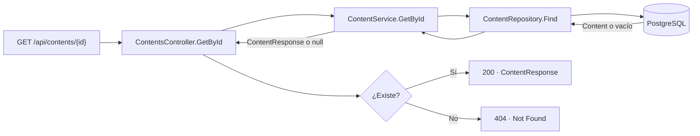

# Catálogo

## `GET /api/contents`

Devuelve los contenidos ordenados por título. El service convierte las entidades `Anime` y `Movie` a `ContentResponse`.

```mermaid
flowchart LR
  Request["GET /api/contents"] --> Controller["ContentsController.GetAll"]
  Controller --> Service["ContentService.GetAll"]
  Service --> Repository["ContentRepository.GetAll"]
  Repository --> Database[("PostgreSQL")]
  Database -->|Anime o Movie| Repository
  Repository -->|Entidades| Service
  Service -->|ContentResponse[]| Controller
  Controller --> Response["200 · ContentResponse[]"]
```

## `GET /api/contents/{id}`

Busca un contenido por identificador. El controlador responde `404` si no existe; si existe, responde `200` con `ContentResponse`.



En Angular, la portada y el catálogo usan `GET /api/contents` y comparten la tarjeta que enlaza al detalle. El detalle usa `GET /api/contents/{id}`. En desarrollo, el proxy de Angular redirige `/api` a `localhost:5228`; PostgreSQL escucha en `127.0.0.1:5434`.
