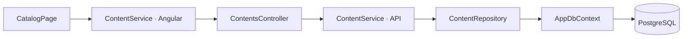

# Catálogo

`GET /api/contents` devuelve identificador, tipo, título, descripción, portada y géneros, ordenados por título. La base incluye dos contenidos ficticios de demostración.

Las flechas indican llamadas. El repository recupera entidades `Anime` o `Movie`, ambas derivadas de `Content`; el service las convierte a `ContentResponse`.

En desarrollo, Angular redirige `/api` a `localhost:5228` mediante su proxy. PostgreSQL escucha en `127.0.0.1:5434` y conserva sus datos en un volumen Docker.
